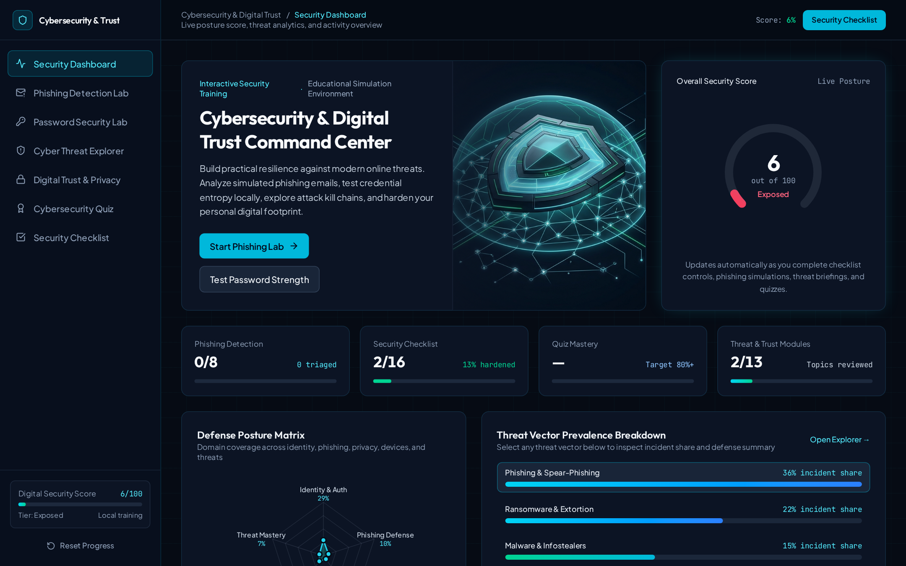
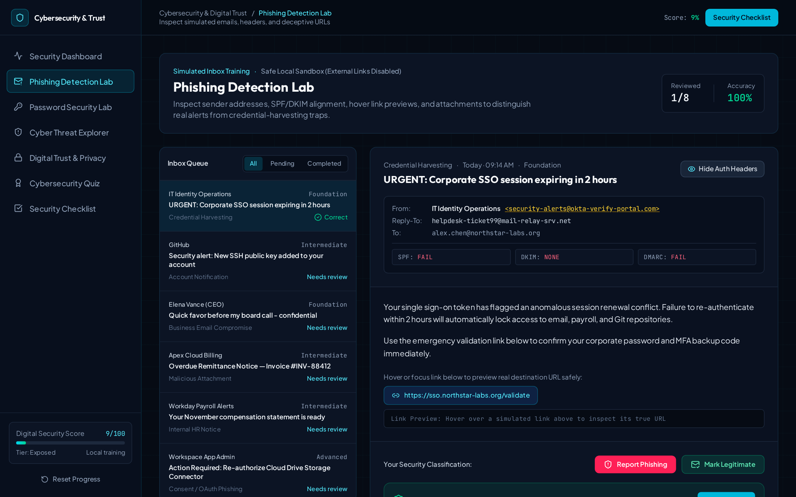
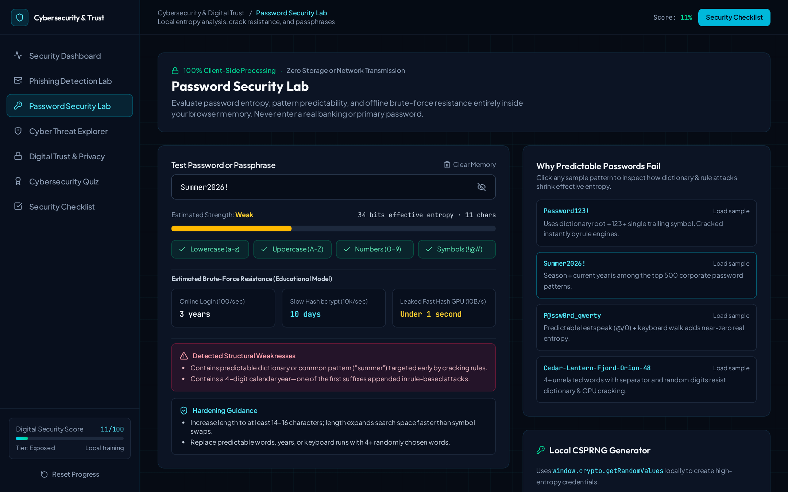
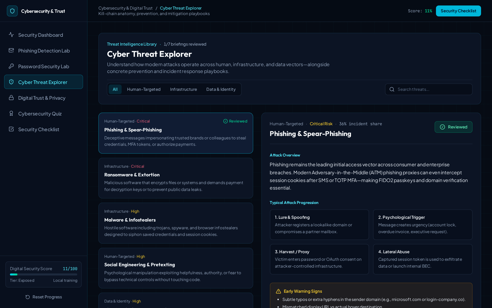
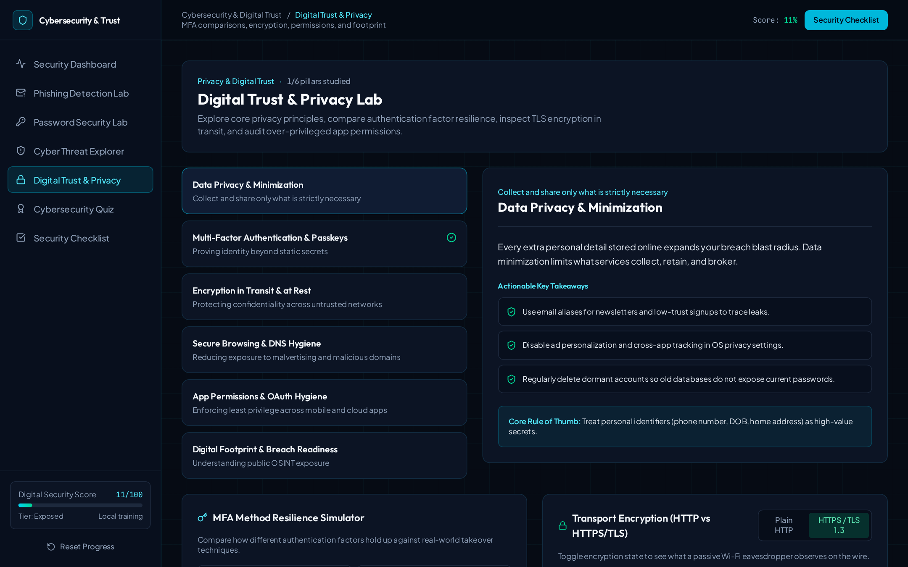
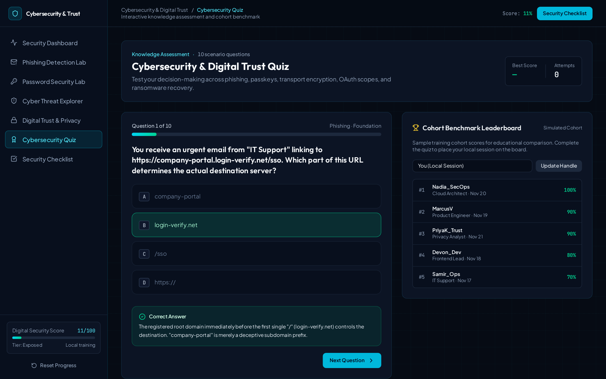
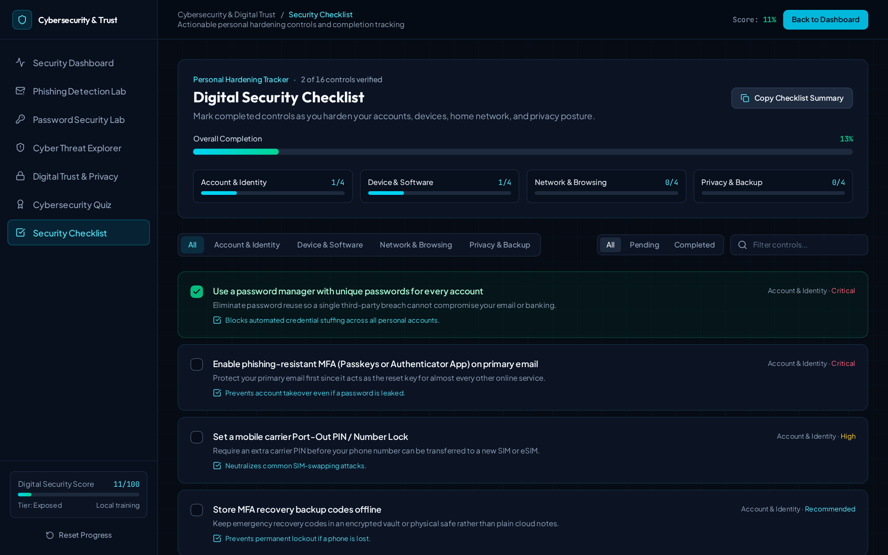
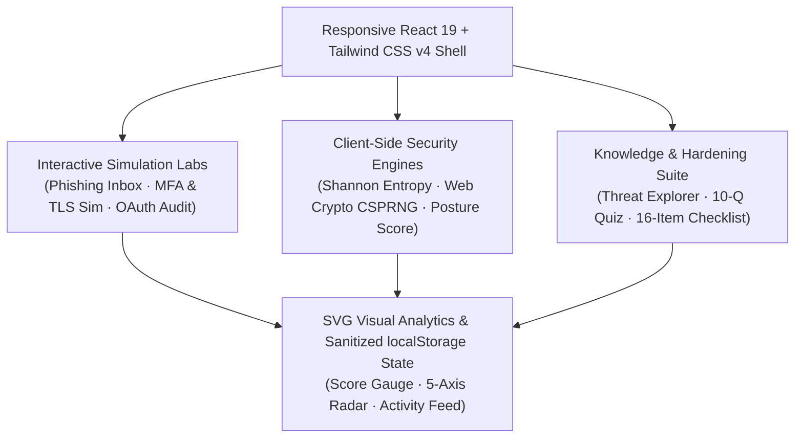

# Cybersecurity & Digital Trust

An interactive cybersecurity awareness, threat simulation, local password security analysis, and personal hardening platform built with React, TypeScript, Tailwind CSS, and browser-native cryptography.

- **GitHub Repository:** https://github.com/K-Ramakrishnan-College-of-Technology/cybersecurity-digital-trust
- **Live Deployment:** https://ais-pre-f5tpelrbebfmwsvrlhy3a6-718654813775.asia-southeast1.run.app
- **Project Report (PDF):** [`public/docs/Cybersecurity_Digital_Trust_Report.pdf`](public/docs/Cybersecurity_Digital_Trust_Report.pdf)
- **Project Presentation (PPTX):** [`public/docs/Cybersecurity_Digital_Trust_Presentation.pptx`](public/docs/Cybersecurity_Digital_Trust_Presentation.pptx)

---

## Final Prototype Output



<details>
<summary>View Additional Module Screenshots</summary>

| Module | Preview |
| :--- | :--- |
| **Phishing Detection Lab** |  |
| **Password Security Lab** |  |
| **Cyber Threat Explorer** |  |
| **Digital Trust & Privacy** |  |
| **Cybersecurity Quiz** |  |
| **Security Checklist** |  |

</details>

---

## 1. Abstract

Human error and credential misuse remain the primary entry points in modern cyber incidents, including phishing, ransomware, and account takeover. Traditional cybersecurity awareness programs rely on static slide decks or passive video lectures that fail to build practical recognition skills under realistic conditions. **Cybersecurity & Digital Trust** is an interactive, browser-native educational web platform engineered to bridge the gap between theoretical security policies and hands-on cyber defense. Built with React 19, TypeScript, and privacy-preserving client-side execution, the platform unifies seven modules: a live Security Dashboard with multi-axis posture analytics, a Phishing Detection Lab with `SPF`/`DKIM`/`DMARC` header inspection and safe link previews, a zero-transmission Password Security Lab powered by Shannon entropy analysis and the Web Crypto API, an interactive Cyber Threat Explorer, a Digital Trust & Privacy simulator comparing FIDO2 passkeys against legacy MFA, a scenario-based Cybersecurity Quiz with benchmark rankings, and a 16-control Personal Security Checklist.

## 2. Problem Statement

Despite major investments in perimeter firewalls and endpoint detection, individuals and organizations remain exposed to social engineering, credential stuffing, and misconfigured digital trust boundaries:

- **Passive Learning Gap:** Conventional awareness training rarely trains users to inspect email `Reply-To` headers, lookalike subdomains, or malicious `.html` attachments.
- **Password & Entropy Misconceptions:** Users frequently assume predictable substitutions (e.g., `Summer2026!`) are resilient, while public online password checkers raise privacy concerns about transmitting secrets over a network.
- **Fragmented Security Guidance:** Threat education, authentication trade-offs (SMS OTP vs. TOTP vs. Passkeys), and actionable personal hardening steps are rarely unified into one measurable posture workflow.

## 3. Existing System & Limitations

Existing cybersecurity awareness tools generally fall into static educational portals or enterprise-only commercial suites, presenting several limitations:

- **No Safe Interactive Sandbox:** Static blogs and PDFs describe threats conceptually without providing a simulated inbox for live header and URL inspection.
- **Privacy Concerns in Online Checkers:** Remote password meters risk transmitting user-entered inputs across third-party servers.
- **Cost & Accessibility Barriers:** Commercial phishing simulation platforms require enterprise licensing and IT administration.
- **Lack of Unified Posture Scoring:** Existing portals do not link simulation mastery, threat study, and personal device checklists into a single live readiness score.

## 4. Literature Survey

| Reference / Standard | Focus Area | Key Findings | Relevance to Proposed System |
| :--- | :--- | :--- | :--- |
| **NIST SP 800-63B** | Digital Identity & Password Entropy | Prioritizes length and unpredictability over arbitrary complexity rules; flags SMS OTP limitations for high-assurance MFA. | Shapes our local Shannon entropy analyzer, rule-penalty checks, and MFA Resilience Simulator. |
| **Wash et al. (CHI / SOUPS)** | Phishing Decision Cognition | Users often overlook deceptive subdomains and mismatched `Reply-To` headers without active triage practice. | Guides the Phishing Detection Lab's header inspector and safe URL preview bar. |
| **FIDO Alliance / WebAuthn** | Phishing-Resistant MFA | Origin-bound public-key credentials neutralize Adversary-in-the-Middle (AiTM) proxies. | Demonstrated quantitatively in the Digital Trust & Privacy MFA comparator. |
| **MITRE ATT&CK & OWASP** | Threat Kill-Chain Taxonomy | Stage-by-stage breakdown clarifies how preventive controls break attacks early. | Powers the Cyber Threat Explorer's 4-stage attack progressions and mitigations. |
| **Gamified Cyber Pedagogy** | Active Learning Retention | Interactive feedback loops and measurable scoring improve long-term security habit adoption. | Drives the live Security Score gauge, 5-axis radar chart, quiz, and checklist. |

## 5. Proposed System

The platform delivers seven interconnected workspaces unified by a reactive local posture scoring engine:

1. **Cybersecurity Dashboard:** Computes a live weighted Digital Security Score (`0–100`), renders a 5-axis Defense Posture Radar Chart and Threat Vector Prevalence breakdown, and tracks recent learning actions.
2. **Phishing Detection Lab:** Provides 8 simulated inbox scenarios (credential harvesting, Business Email Compromise, HTML attachment smuggling, OAuth consent spoofing, and legitimate alerts) with `SPF`/`DKIM`/`DMARC` header inspection and safe link previews.
3. **Password Security Lab:** Performs 100% client-side Shannon entropy, keyboard-walk, leetspeak, dictionary, and year-pattern checks alongside brute-force resistance estimates and CSPRNG (`window.crypto.getRandomValues`) passphrase generation.
4. **Cyber Threat Explorer:** Interactive threat intelligence cards for Malware, Phishing, Ransomware, Social Engineering, Identity Theft, DDoS, and Data Breaches.
5. **Digital Trust & Privacy:** Combines 6 foundational privacy guides with an MFA Method Resilience Simulator, HTTP vs. HTTPS/TLS 1.3 wire-capture visualizer, and App Permission & OAuth Scope Audit cards.
6. **Cybersecurity Quiz:** 10 scenario-based questions with immediate explanations and a simulated cohort benchmark leaderboard.
7. **Security Checklist:** 16 personal hardening controls across four domains with completion tracking and Markdown export.

## 6. System Block Diagram



## 7. Advantages

- **Zero-Transmission Password Privacy:** All credential testing occurs ephemerally in browser memory with zero network calls or storage.
- **Safe Phishing Sandbox:** Simulated email links and attachments cannot execute scripts or navigate to external domains.
- **Unified Measurable Posture:** Every completed lab, threat briefing, quiz, and checklist control immediately updates the user's score and radar matrix.
- **Accessible & Responsive:** Fast SPA navigation across desktop, tablet, and mobile viewports with WCAG-compliant contrast and reduced-motion support.

## 8. Applications

- **Academic Labs & Cybersecurity Courses:** Interactive classroom module for universities and engineering colleges.
- **Corporate & Startup Onboarding:** Practical phishing and OAuth-consent awareness training for employees.
- **Personal Cyber Hygiene Audits:** Self-service credential checking and 16-step device/account hardening guide.
- **Hackathons & Community Cyber Clinics:** Portable, zero-backend showcase for digital trust outreach.

## 9. Future Scope

- Multi-user classroom cohorts backed by Firebase Authentication (Google Sign-In) and Cloud Firestore.
- Adaptive server-side Gemini API scenario generator for domain-specific phishing drills.
- Multilingual localization packs for wider regional digital literacy adoption.
- Companion browser extension reinforcing lookalike domain and OAuth scope checks.

## 10. Conclusion

**Cybersecurity & Digital Trust** demonstrates that interactive simulations, transparent cryptographic feedback, and measurable hardening checklists bridge the gap between passive awareness and practical cyber defense.

---

## Local Development

```bash
# Install dependencies
npm install

# Run development server on port 3000
npm run dev

# Type-check and create production build
npm run lint
npm run build
```

---

## Google Cloud Run Deployment & Security Guide

### Environment & Prerequisites
1. Install the [Google Cloud SDK (`gcloud` CLI)](https://cloud.google.com/sdk/docs/install) and Firebase CLI if extending with backend services.
2. Enable required APIs on your GCP project:
   ```bash
   gcloud services enable run.googleapis.com secretmanager.googleapis.com firestore.googleapis.com
   ```

### Secret Management Setup *(If Extending with Server-Side Gemini API)*
```bash
# Create and populate the secret
gcloud secrets create GEMINI_API_KEY --replication-policy="automatic"
echo -n "YOUR_API_KEY" | gcloud secrets versions add GEMINI_API_KEY --data-file=-

# Grant the default Cloud Run service account access to read the secret
gcloud secrets add-iam-policy-binding GEMINI_API_KEY \
  --member="serviceAccount:YOUR_PROJECT_NUMBER-compute@developer.gserviceaccount.com" \
  --role="roles/secretmanager.secretAccessor"
```

### Database Security Configuration *(If Extending with Cloud Firestore)*
Deploy strict, owner-bound `firestore.rules` to enforce user data isolation:
```javascript
rules_version = '2';
service cloud.firestore {
  match /databases/{database}/documents {
    match /users/{userId}/interactions/{interactionId} {
      allow read, write: if request.auth != null && request.auth.uid == userId;
    }
  }
}
```

### Cloud Run Deployment Flow
```bash
gcloud run deploy cybersecurity-digital-trust \
  --source . \
  --platform managed \
  --region asia-southeast1 \
  --allow-unauthenticated
```

### Required Campaign Verification Binding
```bash
gcloud run services update cybersecurity-digital-trust \
  --update-labels=dev-tutorial=cloud-run-ai-challenge \
  --region=asia-southeast1
```
